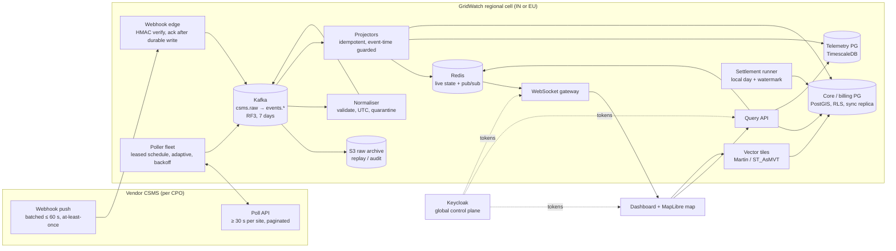
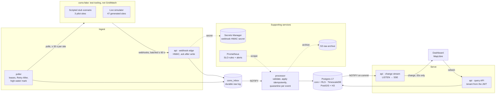
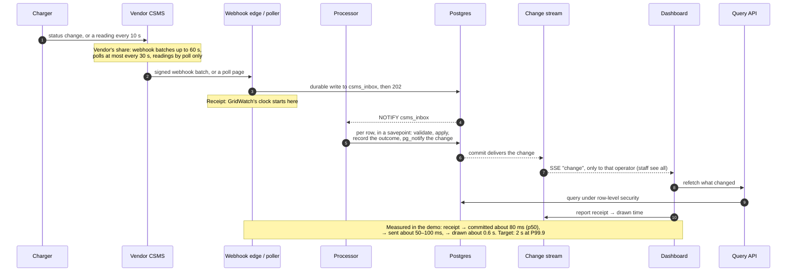
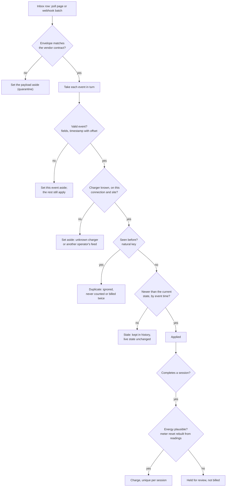
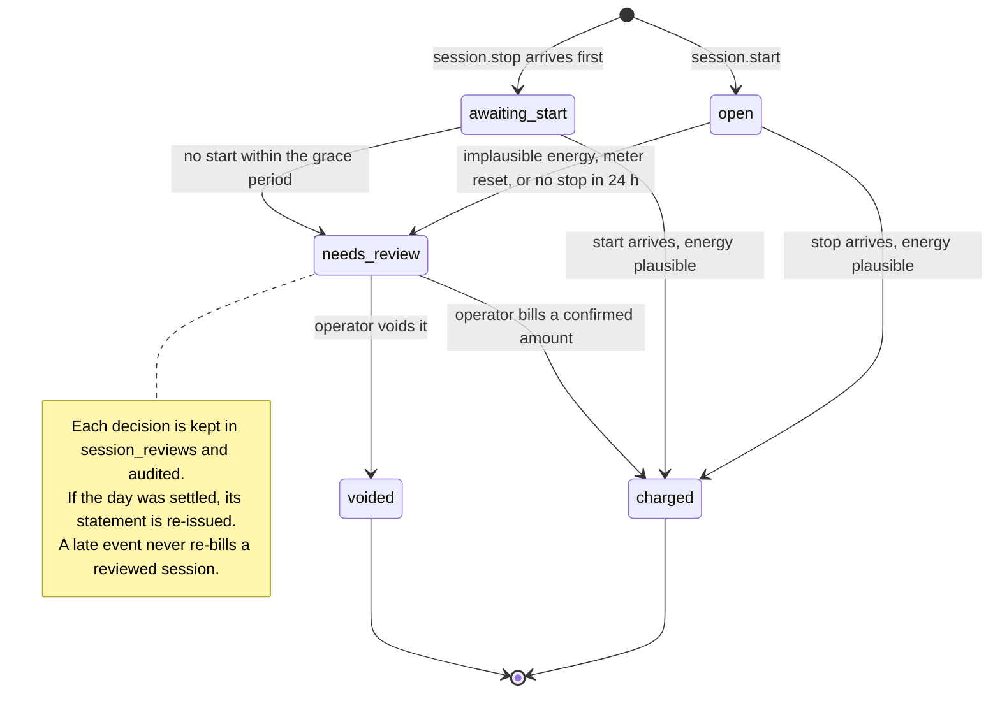
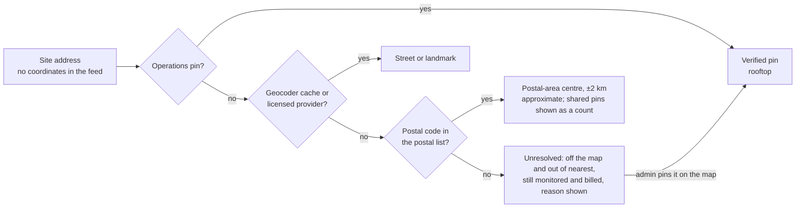
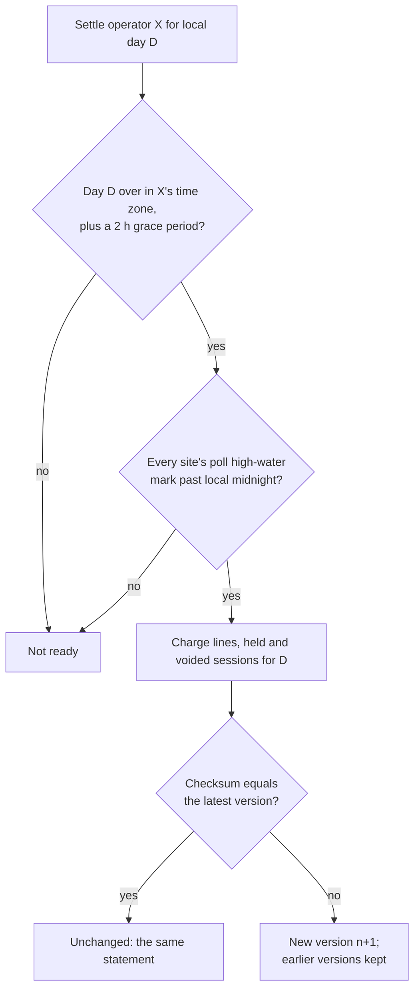
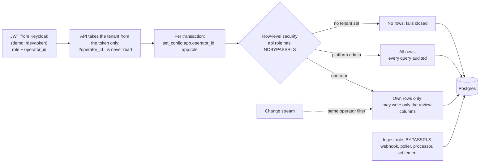

# GridWatch: EV network monitoring, take-home submission

| Part | Where | What it is |
|---|---|---|
| **A** | [docs/01-architecture.md](docs/01-architecture.md) | Architecture and design for 50k chargers / 12k sites in India and Germany: data flow, storage, GIS, freshness, HA/DR, sizing, security, observability, decision log, what I would not build |
| **B** | [docs/02-architecture-review.md](docs/02-architecture-review.md) | Review of the draft architecture, ranked by severity, with fixes and sign-off questions |
| **C** | this repository | A runnable slice of the riskiest path: vendor CSMS → normalise → store → live status, nearest-available and daily settlement, correct under duplicates, reordering, malformed data and meter resets |
| — | [docs/03-questions-and-assumptions.md](docs/03-questions-and-assumptions.md) | Questions for the client, the assumptions made meanwhile, and data-quality findings in the provided stubs |
| — | [Engineering diagrams](#engineering-diagrams) | Architecture, the path of one event, failure handling, billing, geocoding, settlement and tenancy, drawn in this README |

## Run it

Requirements: Docker with Compose v2 and about 4 GB of memory for Docker. The first start pulls about 2 GB of images.

```bash
docker compose up --build
```

That single command:
1. Starts Postgres (TimescaleDB + PostGIS) and LocalStack.
2. Applies the Terraform in `infra/terraform` to LocalStack (S3 raw-payload archive, Secrets Manager).
3. Migrates and seeds the pilot catalogue, and geocodes the sites.
4. Starts the API, processor, poller, a fake vendor CSMS and Prometheus.

The fake vendor plays the stub scenario on the 3 pilot sites in about a minute, and keeps the 47 generated sites live: sessions start and stop, chargers read every 10 s, faults come and go, and the feed misbehaves the way the brief says it does. Then:

| Open | For |
|---|---|
| http://localhost:8080/dashboard | The dashboard on live data. **Operations** is the control room's view in plain language: free connectors, live charging, sites needing attention, the network map (with density and coverage-gap layers), coverage by area, a free-charger finder, and sessions with billing (with the review of held sessions). It updates as changes arrive. **How it works** shows the evidence: every failure point and how often it happened, data delay split into the vendor's share and ours (with receipt → screen measured on this page), the per-event ingestion log, and (as GridWatch admin) vendor calls and set-aside records. Switch "Demo: view as" between Acme, Stadtwerke and GridWatch admin |
| Held sessions, end to end | As **Acme Charge**, scroll to **Charging sessions and billing**: `sess-in-77c` (meter reset) and `sess-in-44a` (more energy than the charger can deliver) are held, not billed. Press **Review**, then bill an amount you have confirmed or void the session, with a note. The decision is kept and audited, and the 9 June statement is re-issued as version 2. GridWatch admin sees the queue but can't decide; the database itself only lets an operator change its own sessions |
| Missing coordinates, end to end | On **Operations**, the **Site locations** panel shows what could be placed, how exactly, and the three sites that could not, each with the reason. They are still monitored and billed but kept off the map and out of find-a-free-charger. Switch to **GridWatch admin**, press **Pin on map** on one of them (for example S-IN-0029 in Chennai), then click the map: the site appears as "Location verified", and the pin is audited. **How it works** opens with a table of every failure point, what GridWatch does about it, and how often it happened in this run |
| `./scripts/demo.sh` | A terminal walkthrough: ingestion log, tenant isolation, nearest charger, sessions, settlement, freshness, vendor calls, infrastructure |
| http://localhost:9090 | Prometheus: `gridwatch_pipeline_latency_seconds`, `gridwatch_source_lag_seconds`, `gridwatch_receipt_to_render_seconds`, `gridwatch:pipeline_latency_seconds:p999_5m`; alerts at `/alerts` (platform and dashboard freshness burn rate, backlog, vendor polls failing, quarantine spike). No Alertmanager in the slice, so alerts are shown, not sent |

Tests (unit + integration against the compose database):

```bash
docker compose --profile test run --rm --build test
```

From a host with Node 22, `npm ci && npm test` does the same; integration tests need `docker compose up -d db`.

Settle a day by hand (each operator on its own local day, gated by the poll watermark):

```bash
docker compose exec api node dist/bin/settle.js --date 2026-06-09
```

Clean up:

```bash
docker compose down -v
```

## What the slice proves

The brief asks for "real ingestion working … one correct, useful aggregate". I built the part most likely to sink the project: **correctness and freshness accounting under the vendor's delivery semantics**, plus the map's hardest query.

| Brief requirement | Where | Evidence |
|---|---|---|
| Ingest from the CSMS stubs | `src/api/webhook.ts`, `src/ingest/poller.ts`, `src/fake-csms/` | Webhooks verified with HMAC and acknowledged only after a durable write; poller with leases, adaptive schedule, high-water mark from `server_time` |
| Normalise | `src/ingest/normalize.ts` | Per-event validation; local offsets → UTC, original kept; strict schemas |
| Store | `migrations/*.sql` | Core tables with RLS; TimescaleDB hypertables with compression and retention; PostGIS geography |
| Useful aggregates | `src/api/server.ts`, `src/geo/coverage.ts` | `/v1/sites/status` (rollup with data age), `/v1/chargers/nearest` (geodesic KNN over fresh Available connectors), `/v1/coverage` (H3 density, chargers per 1,000 km² by area) and `/v1/coverage/gaps` (supply-only gaps that follow live status), daily settlement |
| 429 / 500 / malformed | `src/ingest/poller.ts`, `src/ingest/processor.ts` | 429: honour `Retry-After` and resume from the same cursor. 500: jittered retries, then give up without advancing the high-water mark. Malformed: quarantine per event |
| `docker compose up` | `docker-compose.yml` | One command, ordered by health and completion conditions |
| IaC | `infra/terraform` | Applied to LocalStack by the `terraform` service |
| Tests at failure modes | `test/` | 82 tests, listed below, plus the alert rules under `promtool` |
| Coordinates as they arrive | `src/geo/geocoder.ts` | Addresses only → override, cache, postal fallback; precision recorded; unresolved sites kept off the map |

### The stub scenario, end to end
The live system reproduces the acceptance table from the dashboard design. `./scripts/demo.sh` prints it:

| Stub | Outcome |
|---|---|
| 1a / 1b: paginated poll | 4 + 1 events applied; high-water mark advanced only after page 2 |
| 1c: 429 | `Retry-After: 30` honoured; no retry burst; the cursor would be kept |
| 1d: 500 | Retried with jitter, then 1e served |
| 1e: malformed page | The null-energy reading and the status with no connector are each quarantined; nothing else is lost |
| 2a + 2b: duplicate stop | `sess-de-99x` billed **once**: 41.420 kWh → **€24.93** (sample tariff) |
| 2c: out-of-order | Final status `Available @ 14:33:40`; the older `Charging` is marked stale; the session merges stop-before-start |
| 2c: `sess-in-44a` | **Held**: 11.667 kWh in 7 min 19 s is about 96 kW on a 60 kW charger (its own readings show about 41 kW) |
| 2d: meter reset | **Held**, never billed negative |
| Pilot GroundFailure | Connector shown Faulted; site skipped by nearest-available, with the reason |

### The tests
Unit tests (`test/unit`) need nothing. Integration tests (`test/integration`) run against real Postgres with TimescaleDB and PostGIS.
- **Poller:** pagination with the high-water mark advanced only at the end; 429 mid-pagination resumes from the saved cursor; 500 then success; persistent 500 doesn't advance the high-water mark; failure part-way re-reads the same window.
- **Normaliser:** offsets → UTC; each malformed event in 1e rejected on its own; no-offset timestamps and unknown statuses rejected.
- **Energy:** register delta; implausible energy held; stop-before-start waits; meter reset held; reset rebuilt from bracketing readings; not rebuilt when readings are too far apart.
- **Webhook HMAC:** hex, base64 and prefixed forms accepted; tampered body, wrong secret and missing header rejected; previous secret accepted during rotation.
- **Acceptance:** the stub scenario produces exactly the 16 outcomes in the design.
- **Replay:** replaying every payload changes nothing.
- **Convergence:**
  - All **24 orderings** of the 2c batch converge, both within one batch and as separate deliveries.
  - Two processors racing on the same session converge.
- **Billing:**
  - 2a + 2b + 2a = one charge.
  - Reset rebuilt from readings bills 12.000 kWh = ₹241.00.
  - 77c without readings is never billed.
- **Settlement:**
  - A 02:00 IST run is refused because the Berlin day hasn't ended.
  - It waits for the poll watermark, then settles; a re-run returns the same statement.
  - A 00:30 CEST stop belongs to 10 June in Berlin.
  - Late data issues statement v2.
- **Tenant isolation:** `?operator_id=` is ignored; admins see all tenants and operators get 403 on admin routes; forged tokens rejected; the database returns no rows when no tenant is set.
- **Webhook endpoint:** a bad signature stores nothing; a good one is acknowledged after the write.
- **Nearest-available:** geodesic distance within 0.5% of haversine; faulted, stale and ungeocoded sites skipped with reasons; never another tenant's chargers.
- **Geocoding:** a manual pin beats every later step; the postal fallback says it is approximate (±2 km); an address that can't be placed returns nothing instead of a guess, with the reason (no postal code, or a postal code we don't cover).
- **Push:** a committed change is announced once, and re-reads or bad payloads announce nothing; each stream gets only its own operator's changes while staff get all; no token, no stream; reported render times feed the tile verdict, which says "measuring" below 1,000 samples; malformed or flooding reports are refused.
- **Live simulator:** registers never fall and power never exceeds the charger; readings every 10 s; sessions bill plausibly; the same run however often it is advanced; `since` and the cursor are honoured; meter values never go by webhook and batches are held 5–60 s; the pilot sites get byte-identical responses with live mode on or off; a site polled again within 30 s gets 429.
- **Long-running volume:** the ingestion log and vendor-call view show the newest rows and count all of them, the pilot log stays intact, and the scripted 429 and 500 stay in view.
- **Alert rules** (`ops/prometheus/rules.test.yml`, run by `promtool` in CI): each alert fires when it should and stays silent when idle or healthy. Platform freshness is tested with both bucket spellings, `le="1"` and Prometheus 3's `le="1.0"` (the rule once matched only the first, so on Prometheus 3 it could never fire); dashboard freshness pages when renders take over 2 s; a quarantine spike raises a ticket, including when nothing applies at all, but not for a few broken events on a quiet feed.
- **Held-session review:** a confirmed amount is billed at the session's tariff (at the stop's tariff when no start arrived) and the statement becomes v2; voiding moves a session from held to voided; staff get 403 and another operator 404; an amount the charger couldn't deliver is refused; a second decision gets 409; a late start never re-bills a voided session; a direct UPDATE by another operator changes nothing, and only the review columns are writable.
- **Coverage and density:** hexagon counts add up to the placed sites, with unplaced ones listed apart; an operator sees only its own cells; cells finer than a postal-area pin can support are refused (400); approximate cells are flagged; a faulted site's surroundings show as a live gap, and a covered cell becomes one when its site goes quiet.
- **Fixing a missing location:** the reason appears in the map's unresolved list while the site's faults are still tracked; only platform admins can pin (operators get 403); a pin outside the site's country is refused (400); a valid pin puts the site on the map as verified and writes an audit row.

## Engineering diagrams

GitHub draws these from the Mermaid source below.

1. [Production architecture](#1-production-architecture-part-a): what Part A designs
2. [The slice as it runs](#2-the-slice-as-it-runs): what `docker compose up` starts
3. [The path of one event](#3-the-path-of-one-event): where the freshness time goes
4. [Applying an event safely](#4-applying-an-event-safely): duplicates, reordering, bad data
5. [A session's billing lifecycle](#5-a-sessions-billing-lifecycle): hold, review, bill or void
6. [From address to map pin](#6-from-address-to-map-pin): no coordinates in the feed
7. [Daily settlement](#7-daily-settlement): local day, watermark, versions
8. [Tenant isolation](#8-tenant-isolation): who can see and change what

### 1. Production architecture (Part A)
One self-contained cell per region (India, EU). Details and the latency budget are in [Part A §2–3](docs/01-architecture.md#2-architecture-overview).



### 2. The slice as it runs
Every box is a `docker compose` service; S3 and Secrets Manager run in LocalStack, created by Terraform. The slice keeps the production shape with lighter parts: a Postgres inbox stands in for Kafka ([D7](docs/01-architecture.md#d7-slice-uses-a-postgres-inbox-instead-of-kafka)), and LISTEN/NOTIFY with Server-Sent Events stands in for Redis and the WebSocket gateway.



### 3. The path of one event
Most of the delay happens at the vendor, before GridWatch receives anything. The dashboard measures GridWatch's own share from receipt to the moment it is drawn.



### 4. Applying an event safely
At-least-once, unordered delivery with no event IDs. Each event is judged on its own, so one bad event never sinks its batch.



### 5. A session's billing lifecycle
Start and stop can arrive in either order. A session that can't be priced safely is held, never billed a guess; the operator (CPO) decides it.



### 6. From address to map pin
The feed has addresses only. Every pin records how it was found and how exact it is; a site that can't be placed stays monitored and waits for a person.



### 7. Daily settlement
Each operator is settled on its own local day, and only once the data for that day is in.



### 8. Tenant isolation
The database enforces it, not application code: a query that forgets its WHERE clause still can't leak another operator's rows.



## Design summary
Full detail is in [Part A](docs/01-architecture.md). In short:
- **Freshness.**
  - The contract's < 5 s / < 10 s targets can't be met through this vendor interface: webhooks are batched up to 60 s, polls are ≥ 30 s, and meter values come by poll only.
  - We commit to **receipt → screen ≤ 2 s P99.9**, measure the vendor's share separately (`/v1/freshness`), show data age everywhere, and negotiate the feed.
  - The slice pushes committed changes to open dashboards and measures receipt → drawn on screen from the browser: about 0.6 s typical in the demo, most of it a deliberate 500 ms refetch throttle.
- **Correctness.** At-least-once, unordered, no event IDs. So: natural-key idempotency at every sink, live state moves only forward in event time, sessions merge commutatively, charges are unique per session.
- **Storage.** Postgres family in two clusters: telemetry (TimescaleDB, async, rebuildable from Kafka) and core/billing (PostGIS, RLS, synchronous replication). Kafka in front as the durable raw log; S3 as the archive; Redis for the push path.
- **Map.**
  - Geocode at onboarding, recording precision, with human override.
  - `geography` + GiST KNN for nearest-available.
  - H3 and admin polygons for density.
  - Vector tiles plus pushed status deltas to MapLibre.
- **Cells.** One self-contained deployment per region (India, EU) for residency and blast radius; DR in the same jurisdiction.

### Decision log (summary)
| # | Decision | Instead of |
|---|---|---|
| D1 | Re-baseline the freshness KPIs to receipt → screen; report vendor lag separately; negotiate the feed | Promising targets the interface can't meet |
| D2 | PostgreSQL + TimescaleDB + PostGIS, split into telemetry and core clusters | One Postgres for everything, or a zoo of specialised stores |
| D3 | Idempotent, event-time-guarded sinks | Kafka exactly-once or a dedupe cache (the duplicates start at the vendor) |
| D4 | Geocoding pipeline with precision and human override | Requiring CPO coordinates, or geocoding on the fly |
| D5 | Hold implausible and reset sessions for review | Billing a guess or a lower bound |
| D6 | Regional cells | A single global deployment, or active-active writes |
| D7 | The slice uses a Postgres inbox, not Kafka | Spending the slice on infrastructure that's already proven. It doesn't test rebalances or offset rewind |

## Assumptions
The full list with what changes if each is wrong is in [docs/03](docs/03-questions-and-assumptions.md). The main ones:
- The freshness KPIs are ours from receipt.
- The vendor's 30 s limit is per site, and pagination doesn't count.
- A successful poll confirms a site's current state.
- `session_id` is unique per vendor connection.
- The site catalogue comes from onboarding.
- Tariffs are in local currency, with no FX conversion.
- Settlement is a reconciliation ledger, not the legal invoice.
- A session belongs to the local business day of its stop.

## Demo shortcuts (labelled, not hidden)
- **`DEMO_MODE=true`**
  - Enables `POST /dev/token`, so the dashboard can switch personas without Keycloak. Tokens carry the same claims Keycloak would issue.
  - Pauses TimescaleDB retention and compression jobs, because the stub data is dated June 2026 and would be dropped immediately.
- **Synthetic pilot.** The pilot data is a 3-site excerpt, and the "starter kit" it mentions wasn't provided. `scripts/generate-synthetic-pilot.mjs` deterministically expands it to the brief's 50 sites / 220 chargers.
  - Every generated site is marked `synthetic`.
  - Synthetic sites resolve to postal-code centroids, so several share a point. That is what "postal_code precision" looks like on a map.
  - Three synthetic sites cannot be placed on purpose: two have no postal code, and S-IN-0029 (Chennai) has a postal code outside the postal-code list. Each shows its reason on the dashboard.
- **The fake vendor** (`src/fake-csms`) serves the stub payloads in a fixed script and pushes the signed webhooks. It is test tooling, not part of GridWatch.
  - **Live mode** (on by default, `LIVE_SIM=off` to turn it off) simulates the generated sites from a seed, within the vendor contract: a reading every 10 s while charging, served by poll only; status, session and fault events also by webhook, batched and held up to 60 s, shuffled, sometimes delivered twice or with a broken event; 1% of events only appear 2–5 minutes late; random 500s on 2% of polls. The pilot sites are never touched, so the stub scenario and its 16 outcomes are the same with it on or off.
  - The poller re-reads 90 s behind its high-water mark in the demo (`POLL_OVERLAP_SEC`), so each reading is fetched about twice, not ten times; the hourly reconciliation catches the late ones.
- **Sample tariffs** (`seed/tariffs.json`, `is_sample = true`): Acme ₹18.00/kWh + ₹25, Stadtwerke €0.59/kWh + €0.49, excluding tax.
- **Hand-entered coordinates.** Coordinates: none come from Cidroy's data. 3 site pins and 21 postal-code centres were entered by hand as approximate stand-ins for an operations pin, a geocoder cache and a postal dataset. They are not verified positions. The dashboard labels them "(demo value)" and says the same under the map.
- **Polling interval.** The demo polls idle sites every 60 s so the scenario finishes quickly; production would use 2–5 min.
- **LocalStack is pinned to 4.14.0,** the last release that runs without an account token.

## Repository layout
```
docs/                 Part A, Part B, questions and assumptions
src/
  api/                Fastify API: webhook receiver, query endpoints, auth, site status, freshness
  csms/               Vendor contract: schemas, HTTP client, HMAC
  ingest/             Normaliser, apply logic, processor, poller (+ poll store)
  billing/            Session energy rules, settlement
  geo/                Geocoding chain
  archive/            S3 raw archive, Secrets Manager
  fake-csms/          Stand-in vendor for the demo
  bin/                Entrypoints: api, processor, poller, migrate, settle, mint-token, fake-csms
migrations/           Plain SQL, applied in order
seed/                 Pilot data (verbatim), synthetic expansion, gazetteer, tariffs, geocode seed
fixtures/stubs/       The vendor stub payloads, verbatim
public/               Dashboard page (HTML/JS/CSS, MapLibre)
infra/terraform/      S3 + Secrets Manager (LocalStack locally)
ops/prometheus/       Scrape config, SLO recording rules, burn-rate alerts
test/                 unit/ and integration/
scripts/              demo.sh, synthetic pilot generator
```

## API
All `/v1` routes need `Authorization: Bearer <JWT>`. The tenant comes from the token's `operator_id` claim and nothing else.

| Route | Returns |
|---|---|
| `POST /webhooks/csms/:connectionId` | Vendor webhook: HMAC verified, stored, 202 |
| `GET /v1/sites/status?as_of=` | Per-site rollup with connector status, faults, data age, geocode precision |
| `GET /v1/map/sites` | GeoJSON of geocoded sites + list of unresolved ones |
| `GET /v1/chargers/nearest?lat=&lng=&max_km=&limit=&as_of=&include_synthetic=` | Nearest available connectors, closer sites skipped with reasons (`include_synthetic=false` leaves out generated demo sites) |
| `GET /v1/coverage?res=4-6&include_synthetic=` | Density on the H3 grid: hexagons with sites, chargers and free connectors; ~1,770 km² areas with chargers per 1,000 km²; a line per country |
| `GET /v1/coverage/gaps?max_km=&include_synthetic=` | Inside the metro areas served: cells more than `max_km` from any charger, or from one free and working now. Supply only |
| `GET /v1/sessions?date=&status=&include_synthetic=` | Sessions with billing status, review reason, charge and the latest review; `status=needs_review` is the review queue |
| `POST /v1/sessions/:connectionId/:sessionId/review` | The owning operator only: `{action: "bill", energyKwh, note}` or `{action: "void", note}`. Kept in `session_reviews` and audited; re-issues the day's statement if it was settled |
| `GET /v1/settlement/statements?date=` | Latest statement version per operator and day |
| `GET /v1/ingestion/events` | What happened to each event, and why |
| `GET /v1/freshness` | Vendor age when served vs. platform latency per KPI; the tile KPI from browser-reported receipt → render times |
| `GET /v1/stream` | Server-Sent Events: `hello`, then a `change` (IDs and kinds only) whenever the caller's network changes, `ping` every 15 s. Read with `fetch`, so the token stays in a header |
| `POST /v1/freshness/render` | The dashboard reports receipt → drawn times (`{samplesMs: [...]}`, at most 100 per post, rate-limited) |
| `GET /v1/admin/csms-calls`, `GET /v1/admin/quarantine` | Platform admins only, audited |
| `POST /v1/admin/sites/:siteId/location` | Platform admins only, audited: pin a site (`{lat, lng, note}`), checked against the site's country. Stored as a manual override, which wins over any geocoder result |
| `GET /metrics`, `/healthz`, `/readyz` | Operations |

Get a token outside the dashboard:

```bash
docker compose exec api node dist/bin/mint-token.js acme-charge
```

## Where I stopped, and what's next
**Done:** everything above, run from a clean `docker compose down -v && docker compose up --build`, with all 82 tests passing.

**Next, in priority order:**
1. **Swap the inbox for Kafka** (D7). Put `processRow` behind a consumer and test rebalances and the offset-rewind runbook after a database failover. Load-test to 20k events/s to check the sizing in Part A §10.
2. **Push at production scale.** The slice pushes over Server-Sent Events from one Postgres LISTEN per API process and measures receipt → render from the browser. Production moves this to Kafka → Redis live state → a WebSocket gateway, sends deltas applied as MapLibre `feature-state` instead of refetching, and keeps the same browser-reported measurement.
3. **Telemetry rollups.** Continuous aggregates with `counter_agg` (reset-aware energy) and `state_agg` (utilisation), and an integer `connector_key` instead of text IDs in hypertables.
4. **Density and coverage, production version.** The slice computes H3 density and supply-only gaps per request. Production adds admin boundary polygons in `site_regions` (mapped at geocode time, with India's official boundaries), cells materialised at geocode time, a demand layer (population, traffic) to rank gaps, and vector tiles via Martin.
5. **Settlement operations.** Scheduled per-operator runs after local midnight, a reviewer role in Keycloak (so not every operator user can bill), credit notes for corrections after invoicing, and re-rating when a tariff changes. The exceptions queue itself is built.
6. **Soak and scale with the simulator.** It runs the 47 generated sites live; next is a profile at production size (12k sites) against the Kafka path, run for days, with the SLO alerts wired to Alertmanager.
7. **Production IaC.** The Terraform module pointed at real AWS with an S3 state backend and locking, plus managed Postgres (Multi-AZ), MSK and ElastiCache modules for one regional cell.
