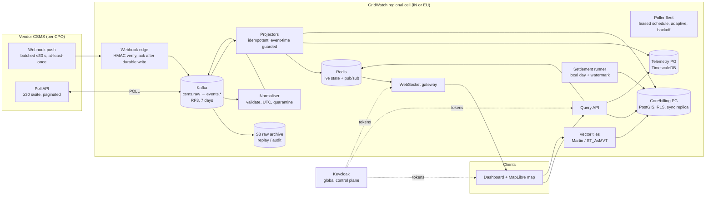

# Part A — GridWatch architecture and design

GridWatch ingests charging-network data from each CPO's vendor CSMS, normalises it, stores it, and shows every operator a live map and dashboards of their network. Production scale is about 50,000 chargers at about 12,000 sites in India and Germany, each reporting roughly every 10 seconds.

This document is about decisions and why. Where something in the brief can't be done as written, it says so and proposes what to do instead.

**Contents**
0. Summary
1. Scope, assumptions, questions
2. Architecture overview
3. Data flow and latency budget
4. Ingestion
5. Correctness under the vendor's delivery guarantees
6. Storage
7. GIS
8. Freshness KPIs: what can and can't be met
9. High availability and disaster recovery
10. Capacity sizing
11. Security and multi-tenancy
12. Observability: proving the KPIs
13. Sessions and settlement
14. Analytics, alerts, forecasting
15. Decision log
16. What I would not build
17. Delivery plan and team

---

## 0. Summary

Five decisions shape everything else:

1. **The freshness KPIs, as written, can't be met through this vendor interface, and we should say so before signing.**
   - Webhooks are batched for up to 60 s, polling is limited to once every 30 s, and meter values only come by poll.
   - No GridWatch design can make a status that the vendor holds for 60 s arrive in under 5 s.
   - What we can own, and will commit to, is **receipt-to-screen ≤ 2 s at P99.9**, measured separately from the vendor's share. We should ask the vendor for an unbatched or streaming feed (§8).
2. **Correctness comes from idempotent, order-independent writes, not from the transport.**
   - The vendor delivers at least once and out of order, with no event IDs.
   - Every sink is keyed by natural keys that include event time. Live state moves only forward in event time. Sessions merge start and stop in any order. Charges are unique per session.
   - Replays, redeliveries and failovers are therefore harmless (§5).
3. **One database family, two clusters.** PostgreSQL with TimescaleDB (telemetry) and PostGIS (map), split into a telemetry cluster and a core/billing cluster.
   - Kafka is the durable raw log in front of them, with S3 as the long-term archive.
   - Redis holds live state for the push path (§6).
4. **The map starts with geocoding, because the feed has no coordinates.**
   - Asynchronous geocoding at onboarding, recording precision and source, with human override and an unresolved queue.
   - Served as vector tiles plus pushed status deltas, with PostGIS KNN for "nearest available" (§7).
5. **Two regional cells (India, EU).** This gives data residency, blast-radius containment and latency to each vendor. A thin global control plane holds identity and the catalogue, never telemetry (§2, §9).

**What was built (Part C)** to prove the riskiest part, the vendor semantics:
- Ingest stubs → normalise → store → live status, nearest-available and daily settlement.
- Coverage and density on the H3 grid, with supply-only gaps that follow live status.
- The exceptions queue: the operator bills or voids a held session, enforced by row-level security, and the day's statement is re-issued.
- Changes pushed to dashboards, with receipt → screen measured from the browser; a live simulator keeps the generated sites busy within the vendor contract.
- 82 tests aimed at the failure modes, plus `promtool` tests for the alert rules.
- The slice uses a Postgres inbox where production would use Kafka (decision D7).

---

## 1. Scope, assumptions, questions

**In scope:**
- Ingestion from the vendor CSMS (poll + webhook).
- Live status, map, nearest-available, density.
- Sessions and daily settlement.
- Analytics and alerts.
- HA/DR, security, observability.

**Out of scope:** talking to chargers (OCPP), driver apps, payments, demand-forecast models (approach only, §14).

**Assumptions** (A-numbers are referenced below):

| # | Assumption | Why it matters |
|---|---|---|
| A1 | About 1.5 connectors per charger (pilot ratio); sized for 2 | Meter values are per connector: 7.5k–10k events/s, not 5k |
| A2 | Production split about 60% India, 40% Germany | Per-region sizing |
| A3 | The vendor's 30 s limit is per site; pagination requests don't count | Polling budget; if pagination counts, catch-up is slower (§10) |
| A4 | A successful poll confirms the site's current state as of `server_time` | Data age is "time since the vendor last confirmed", not "time since the last change" |
| A5 | `session_id` is unique per vendor connection | Session key is (connection, session_id) |
| A6 | The site catalogue comes from CPO onboarding: no vendor endpoint lists sites | The poller needs a site list |
| A7 | Tariffs are per CPO, in local currency; no FX conversion | "Convert to local currency" is read as "rate in the CPO's currency" |
| A8 | Settlement is a reconciliation ledger for the CPO, not the legal invoice to drivers | Legal invoicing (tax, numbering, German calibration law) would add scope |
| A9 | A session belongs to the business day of its **stop**, in the site's IANA zone | Deterministic daily totals |
| A10 | Region-wide outage is a DR event outside the 99.9% SLA | RPO/RTO targets (§9) |
| A11 | Peak about 2,000 concurrent dashboard users across tenants | API and push sizing |

**Questions I would send the client** (full list: [03-questions-and-assumptions.md](03-questions-and-assumptions.md)). The ones that change the design:
1. Is each freshness KPI measured from the charger event, the vendor send, or our receipt?
2. Can the vendor shorten webhook batching and send meter values by webhook?
3. Is GridWatch's settlement the legal invoice or a reconciliation ledger?
4. Data-residency requirements, including backups and DR.
5. Retention for raw telemetry, as opposed to rollups and invoices.

---

## 2. Architecture overview

Each region is a self-contained **cell**: India in Mumbai, with DR in Hyderabad; EU in Frankfurt, with DR in another EU region. A CPO is homed in one cell. Vendor connections, data, processing and dashboards for that CPO live there.



| Component | Responsibility | Scales by | Notes |
|---|---|---|---|
| Webhook edge | Verify HMAC on raw body, produce to `csms.raw` (`acks=all`), answer 202. Nothing else | Stateless pods | Answers 503 if Kafka is unavailable, so the vendor redelivers |
| Poller fleet | Lease due sites, poll with backoff and `Retry-After`, write pages to `csms.raw`, advance the high-water mark after the last page | Pods; leases avoid overlap | Per-connection concurrency cap and circuit breaker |
| Normaliser | Validate each event, normalise to UTC, attribute to tenant via the catalogue, quarantine bad events | Kafka partitions | One bad event never sinks a batch |
| Projectors | Apply events idempotently: live state (Redis + PG), telemetry (Timescale), sessions and charges (core) | Kafka partitions (keyed by charger) | Sinks are idempotent; ordering by event time, not offsets |
| WebSocket gateway | Push status deltas and tile counters per tenant | Connections | Subscribes to Redis pub/sub per tenant |
| Query API | REST for dashboards, map, nearest, sessions, settlement, admin | Stateless pods | Tenant from token; RLS in Postgres |
| Tile server | Static site layer as vector tiles | Stateless + CDN | Tenant-scoped URLs, short TTL |
| Settlement runner | Daily statement per operator per local day, gated by watermark | Cron + advisory lock | Versioned statements |
| Keycloak (global) | Users, tenants, roles → JWT | Clustered | Holds no telemetry |

---

## 3. Data flow and latency budget

**Status change, webhook path.** Times are measured from GridWatch receipt; the vendor's share (0–60 s) comes before this.

| Step | What happens | P99.9 budget |
|---|---|---|
| 1 | Edge verifies HMAC, produces to `csms.raw` (3-AZ `acks=all`), returns 202 | 50 ms |
| 2 | Normaliser consumes, validates, splits into typed events, produces | 100 ms |
| 3 | Status projector: event-time guarded compare-and-set in Redis (Lua), publish delta to tenant channel | 50 ms |
| 4 | WebSocket gateway pushes delta to subscribed browsers | 150 ms |
| 5 | Browser applies to tile counters and map feature-state, renders | 100 ms |
| — | Postgres projections (history, `connector_state`) written in batches off the push path | ≤ 1 s, not on path |
| **Total** | | **≈ 450 ms**, target ≤ 1.5 s P99.9 with headroom for GC, rebalances, retries |

**Meter value, poll path.** The same steps, but the vendor's share is the poll interval (30 s for sites with a session in progress) plus the page's age.

**Session stop.** Step 3 merges the stop into the session record in core Postgres under a row lock. If start and stop are both known, it rates the session and inserts the charge (unique per session).

---

## 4. Ingestion

### 4.1 Webhook edge
- Raw body as bytes; HMAC-SHA256 checked with a constant-time compare against every currently valid secret for that connection (two during rotation).
- Accept → write to the durable log → 202. Never acknowledge before the write: if Kafka (or, in the slice, the inbox) can't take it, answer 503 and let the vendor's at-least-once redelivery do its job.
- Body-size limit; per-connection rate limit; optional IP allowlist.
- A signed body that isn't JSON is acknowledged and quarantined. Redelivering it would never fix it, so we alert instead.

### 4.2 Poller
**Budget.** 12,000 sites ÷ 30 s = **400 req/s** if every site is polled at the maximum rate, against a vendor that returns 500s under load. Instead the poller is **adaptive**:
- 30 s only for sites with a session in progress, because power and energy only come by poll.
- 2–5 min for idle sites, whose status changes reach us by webhook.
- With about 30% of sites active at peak, that is about **190 req/s** (§10).

**Scheduling.**
- `poll_state` has one row per site with `next_poll_at`, a lease, the high-water mark and a saved cursor.
- Workers claim due sites with `FOR UPDATE SKIP LOCKED`, so any number of pollers run without coordination.
- The minimum 30 s per site is enforced at claim time as well as by scheduling.

**High-water mark and cursor.**
- `since = high-water mark − overlap (5 min)`. Pages aren't time-ordered (stub 1b's fault is older than 1a's events) and the cursor is offset-based over a changing set (`eyJvZmZzZXQiOjUwfQ==` decodes to `{"offset":50}`). Duplicates are harmless; gaps are not.
- The high-water mark is the vendor's **`server_time`** of the first page, never our clock or the charger's. It advances only after the last page is stored.
- Every hour a deep **reconciliation** poll re-asks a 2 h window. Events it finds that weren't seen before are counted as "missed by the normal path", which measures how good the cheap path is.

**Error handling.**

| Vendor response | Action |
|---|---|
| 200 with `next_cursor` | Store page, fetch next |
| 200 final page | Store, advance high-water mark, schedule next poll adaptively |
| 429 | Honour `Retry-After` (header, HTTP date, or body). **Keep the cursor** and resume from that page after the wait. No retry burst |
| 500, timeout, network | Retry the same request up to 3× with full-jitter exponential backoff (≤ 4 s). Then abort the cycle **without** advancing the high-water mark; next poll backs off 60 s → 5 min |
| Malformed page (valid JSON) | Store as-is; bad events are quarantined one by one downstream |
| Invalid page (not JSON, wrong site) | Quarantine raw body, abort cycle, alert |
| Most cycles failing on a connection | Circuit breaker opens: stop adding load for 60 s, then probe |

**Vendor outage.**
- Webhooks fail on their side (best-effort, may be lost).
- Polls resume from the high-water mark when the vendor recovers, catching up within the vendor's rate limit (§10).
- Per-charger "offline" alerts are suppressed for that connection, and one "vendor feed degraded" incident is raised.

### 4.3 Normalisation
- Each event is validated on its own against a strict schema. The envelope is validated loosely, so one bad event never sinks a page (stub 1e).
- Timestamps: parse the offset, store as a UTC instant, keep the original string. Reject timestamps with no offset (ambiguous), and reject timestamps more than 5 minutes ahead of vendor time or receipt (a bad charger clock would otherwise win last-write-wins forever).
- Attribution: charger → site → operator from the catalogue. Reject unknown chargers or connectors, and chargers that belong to another connection (a tenant-mismatch guard).
- Quarantine keeps the event, reason and source payload, so it can be replayed once the cause is fixed (for example, a charger onboarded late).

---

## 5. Correctness under the vendor's delivery guarantees

The vendor gives **at-least-once, unordered, batched** delivery with **no event IDs**, and a redelivery carries a new `delivery_id`. Kafka adds its own at-least-once. Exactly-once in the transport would not help, because the duplicates start upstream. So correctness lives in the sinks:

| Data | Idempotency key | Ordering rule |
|---|---|---|
| Meter readings | (charger, connector, ts) | Append-only; a conflicting duplicate (same key, different value) is quarantined |
| Status events (history) | (charger, connector, ts, status) | Append-only |
| Live status | (charger, connector) | Update only if `event_ts > current_ts`; equal timestamps: more severe status wins (deterministic total order) |
| Faults | (charger, connector, ts, code) | Active until a later non-Faulted status (the feed has no "cleared" event) |
| Sessions | (connection, session_id) | Commutative merge of start and stop under a row lock; finalise only when both are known |
| Charges | UNIQUE (connection, session_id) | At most once, ever |

**Proven in Part C:**
- The 2c batch converges to the same state in **all 24 orderings**, within one batch and across separate deliveries, and with two processors racing.
- Replaying every payload changes nothing.
- 2a + 2b + 2a produces one charge.

**Energy is a counter, not a measurement.**
- The register is lifetime Wh. Interval energy = difference of consecutive readings; session energy = stop − start.
- A drop means a reset or meter swap. Across a drop, energy is rebuilt from readings that bracket it closely (≤ 120 s). If they don't, the session is held, never billed negative or guessed (stub 2d).
- In analytics, TimescaleDB Toolkit's `counter_agg` treats resets the same way.

**Plausibility.** Session energy must not exceed `max_kw × duration × 1.1`. `sess-in-44a` (11.667 kWh in 7 min 19 s on a 60 kW charger, about 96 kW average) is held. Its own interval readings show about 41 kW, so the start register or start time is wrong, and we can't tell which.

**After a database failover.**
- The telemetry cluster replicates asynchronously, so a failover can lose the last few seconds of commits whose Kafka offsets were already committed.
- The runbook rewinds consumer groups by a safety margin (5 min) after any telemetry-DB failover.
- Idempotent sinks absorb the replay. This is why idempotency is a design principle, not a nicety.

---

## 6. Storage

### 6.1 What stores what, and why

| Store | Holds | Why this store |
|---|---|---|
| **Kafka** (3 brokers, RF3, 7 days) | `csms.raw` (payloads as received), `events.status / meter / session / fault` (normalised, keyed by charger) | Durable buffer that decouples the vendor's bursts from our writes; replay after bugs or failovers; the acknowledgement boundary for webhooks |
| **S3** (versioned, SSE-KMS, lifecycle to Glacier at 30 days) | Every raw payload, partitioned by source/connection/day | Audit trail for billing disputes; rebuild any store from scratch; cheap |
| **Telemetry Postgres + TimescaleDB** | `meter_readings`, `status_events`, `fault_events` hypertables; continuous aggregates (15 min / hourly / daily) | Time-partitioned, compressed (~10×), retention policies, SQL joins with the catalogue; one engine family for the team to run |
| **Core Postgres + PostGIS** | Operators, sites (geography), chargers, connectors, `connector_state`, sessions, charges, statements, tariffs, audit | Relational integrity for money; RLS for tenancy; GiST spatial index; synchronous replication |
| **Redis** (replicated) | Live connector state, tile counters, pub/sub per tenant | Sub-millisecond reads and fan-out for the push path; fully rebuildable from Postgres |

**Why split telemetry from core?** Telemetry is 99% of writes and has a different failure and recovery profile: rebuildable from Kafka and S3, async replication acceptable. Billing must never lose a commit (synchronous replication), and must not slow down because of a telemetry write storm or compression job. The blast radius stays separated.

### 6.2 Schema sketch (core)

```sql
operators   (operator_id PK, name, country, currency, timezone /* IANA */)
sites       (site_id PK, operator_id FK, connection_id, name, address, country, timezone,
             location geography(Point,4326), geocode_status, geocode_precision, geocode_source,
             geocode_confidence, geocoded_at)              -- GiST(location)
chargers    (charger_id PK, site_id FK, operator_id, connection_id, model, max_kw)
connectors  (charger_id, connector_id, operator_id, site_id, PK(charger_id, connector_id))
connector_state (charger_id, connector_id PK, operator_id, site_id, status, status_ts,
             active_fault_code/severity/ts, power_w, energy_wh, meter_ts, last_seen_at)
sessions    (connection_id, session_id PK, operator_id, site_id, charger_id, connector_id,
             started_at, stopped_at, start_meter_wh, stop_meter_wh, energy_wh, energy_method,
             billing_status /* open|awaiting_start|charged|needs_review */, review_reason)
charges     (charge_id PK, UNIQUE(connection_id, session_id), operator_id, business_date,
             timezone, currency, energy_wh, tariff_id, price_per_kwh, session_fee,
             energy_amount numeric(14,2), total_amount numeric(14,2))
settlement_statements (operator_id, business_date, version PK, totals, held_count, checksum)
tariffs     (tariff_id PK, operator_id, currency, price_per_kwh numeric(12,4),
             session_fee numeric(12,2), valid_from, valid_to)
```

### 6.3 Telemetry

```sql
meter_readings (ts timestamptz, connector_key int, energy_wh bigint, power_w int,
                received_at timestamptz, PRIMARY KEY (connector_key, ts))
  -- hypertable, 1-day chunks; compress segmentby connector_key, orderby ts
  -- after the lateness window; retention 90 days raw
status_events  (ts, connector_key, status smallint, PRIMARY KEY (connector_key, ts, status))  -- 400 days
fault_events   (ts, connector_key, code, severity, ...)                                       -- 2+ years
```

- **Integer surrogate keys** (`connector_key`) halve the row size compared with text IDs. The slice keeps text for readability.
- **Continuous aggregates:**
  - Energy per connector per 15 min with `counter_agg` (reset-aware).
  - Utilisation per connector per hour with `state_agg` (time in each status).
  - Fault counts per site, code and day.
  - Dashboards read these, never raw rows.
- **RLS is not used on hypertables**, because continuous aggregates can't be built on tables with RLS policies. The API never reads raw telemetry. It reads aggregates through tenant-filtered views, joined to RLS-protected catalogue tables.

---

## 7. GIS

### 7.1 Coordinates: there are none in the feed
Sites arrive as address strings, for example `"Sector 18 Metro Station, Gate 3, Noida, UP 201301"`. Geocoding is a **pipeline at onboarding**, never on the hot path:

1. **Manual override.** Operations pins the site, and this always wins. Indian addresses such as "Metro Station, Gate 3" defeat most geocoders, so this step is expected to be used, not an exception.
2. **Geocode cache.** Provider results keyed by normalised address.
3. **Provider.** A licensed geocoder whose terms allow **storing** results. Google's terms limit caching of coordinates to 30 days, so we would use Mapbox permanent geocoding, HERE with storage rights, or self-hosted Nominatim/Pelias on OSM.
4. **Postal centroid fallback.** PIN or PLZ. Coarse, but honest about it.

Every site records `precision` (rooftop / street / landmark / postal_code / city), `source` and `confidence`.
- The map shows an approximate pin as a circle sized by its precision.
- Nearest-charger results carry the precision.
- Unresolved sites stay off the map and out of nearest, and sit in a review queue.
- A reverse check catches wrong results: the geocoded point must fall inside the expected country, state and postal polygon.

Every outcome also records a plain-language reason (`sites.geocode_note`), such as "Address matched only postal area 201301; the pin is the area centre, about ±2 km" or "Postal code 600002 is not in the postal-code list". Operators see it next to the site.

The review queue closes the loop. A platform admin pins an unresolved site with `POST /v1/admin/sites/:siteId/location`. The point is checked against the site's country, stored as a manual override (so it wins over any later geocoder result) and audited. In production this is a staffed operations queue with a reverse check against the postal polygon.

The slice implements steps 1, 2 and 4 with demo data. Three synthetic sites cannot be placed on purpose: two have no postal code, and one (S-IN-0029, Chennai) has a postal code outside the postal-code list. None of the coordinates come from Cidroy's data; they were entered by hand and are labelled as demo values.

### 7.2 Spatial queries
- **Storage.** `geography(Point, 4326)` with a GiST index. Distances are geodesic metres, not degrees.
- **Nearest available.**

  ```sql
  SELECT site_id, ST_Distance(location, :p) AS dist_m
    FROM sites
   WHERE location IS NOT NULL                      -- RLS adds the tenant predicate
   ORDER BY location <-> :p                        -- KNN, index-assisted
   LIMIT 500;
  ```

  Then, in distance order, take the first site with a connector that is **Available, confirmed by the vendor within 5 minutes, and without a critical fault**. Closer sites that were skipped come back with the reason, for example "Faulted" or "Stale: last vendor contact 2 h ago". At 12k sites per region this is a few milliseconds.
- **Within region.**
  - Admin boundaries (country, state, district / Land, Kreis) from GADM or OSM, as `geometry(MultiPolygon)` with GiST.
  - Sites map to regions **once, at geocode time** (`site_regions`), because sites don't move. "Within region" is then a join, not a spatial query.
- **Density and coverage.**
  - Chargers per km² by region = count ÷ `ST_Area(geom::geography) / 1e6`, materialised nightly.
  - For heatmaps and gap detection, an **H3** grid (the `h3` extension ships in the TimescaleDB image) at resolutions 6–8: charger counts per cell.
  - "Gap" = cells with demand signal (population, traffic or POI layers, a later data purchase) and no charger within X km.
- **What the slice builds** (`src/geo/coverage.ts`, `/v1/coverage`, `/v1/coverage/gaps`):
  - Density per H3 cell, computed per request. Resolution is capped at 6 (~36 km²), because most pins are postal-area centres (±2 km, about 12.6 km² of uncertainty); finer cells would be false precision. Cells with approximate pins are flagged.
  - "Regions" are H3 resolution-4 areas (~1,770 km²) named after their main city, with chargers per 1,000 km². Admin polygons wait for an official boundary source.
  - Gaps are supply only: inside each metro's service area (DBSCAN clusters of sites, convex hull + 2 km, resolution-7 cells), a **static gap** has no charger within X km and a **live gap** has chargers but none free and working now. A cell is marked uncertain when the deciding pin is a postal-area centre within 2 km of the limit.

### 7.3 Serving the map
- **Static layer.** Site points and slowly changing attributes as **vector tiles** (MVT) from PostGIS (`ST_AsMVT` via Martin), with tenant-scoped URLs and short CDN TTLs. They are invalidated on catalogue change. Clustering at low zoom comes from tile aggregation.
- **Live layer.** On load: a snapshot of status per site. Then **only deltas** over WebSocket, applied as MapLibre `feature-state` with no re-download.
  - The slice builds the shape of this with less machinery: the processor sends `pg_notify` inside each committed row's savepoint (so a rolled-back row announces nothing), each API process holds one LISTEN connection, and dashboards hold one Server-Sent Events stream filtered to their operator. A change carries IDs only; the page re-reads through the API, so row-level security still decides what it sees. Kafka, Redis and a WebSocket gateway replace those three pieces at scale.
- **Renderer.** MapLibre GL (WebGL) with a commercial or self-hosted OSM basemap. Tens of thousands of points render fine; DOM-marker libraries do not.
- **Load.** About 12k sites and a few dozen status changes per second network-wide is small. The hard part is freshness, not volume.

---

## 8. Freshness KPIs: what can and can't be met

The vendor contract imposes a floor that comes **before** any GridWatch code runs:

| Signal | Target | Vendor floor (event → our receipt) | GridWatch budget (receipt → screen) | Achievable end-to-end? | What we do |
|---|---|---|---|---|---|
| Connector / charger status | < 5 s P99.9 | Webhook batches up to 60 s; poll every ≥ 30 s plus page age | ≤ 1.5 s | **No.** P99.9 is about 60 s at the source | Commit receipt → screen ≤ 2 s; report vendor lag separately; ask for unbatched webhooks |
| Active session power & energy | < 10 s P99.9 | **Poll only**: ≥ 30 s interval + 10 s cadence → up to about 40 s old | ≤ 1.5 s | **No** | Same; ask the vendor for meter values by webhook or a stream; show "as of" on every value |
| Fault / alarm surfaced | < 5 s P99.9 | Same as status | ≤ 1.5 s | **No** | Ask the vendor to send faults immediately, outside the batch (most valuable, smallest volume) |
| Dashboard tile end-to-end | < 2 s P99.9 | n/a (from receipt) | ≤ 1.5 s | **Yes**, if measured from receipt | Push architecture (§3); tiles from live state, never ad-hoc SQL |
| Map live-status update | < 10 s P95 | If batching is uniform over 0–60 s, P95 ≈ 57 s | ≤ 1.5 s | **No** end-to-end; **yes** from receipt | Same |

**What I would put in front of the client:**
1. Define each KPI as **receipt to screen**, which we control, and commit to it with evidence.
2. Report **vendor lag** per tenant as a separate, contractual-information metric, so a breach caused by the vendor's batching is visibly theirs.
3. Negotiate the vendor feed: no batching for status and faults, meter values on the webhook, or a streaming option. Each of those changes the floor, not our architecture.
4. In the product, show **data age** on every tile and marker and grey out stale sites. A value that looks live but isn't is worse than a value marked as 40 s old.

The Part C slice exposes this split (`/v1/freshness`): vendor age when served, measured from the stub pages (14–16 s for status, 90 s for the OverTemperature fault), next to platform latency.

---

## 9. High availability and disaster recovery

Target: **99.9% monthly per region**, which allows 43 minutes a month. Only automated failover fits that budget.

| Component | Failure | What happens to data | Recovery | RPO | RTO |
|---|---|---|---|---|---|
| Webhook edge pod | Crash mid-request | Not acknowledged → vendor redelivers | Other pods behind the load balancer | 0 | seconds |
| Kafka | 1 of 3 brokers | RF3, `min.insync.replicas=2`, `acks=all`: writes continue | Leader election | 0 | < 30 s |
| Kafka | Cluster unavailable | Edge answers 503 → vendor redelivers (best-effort); pollers pause without advancing high-water marks | Restore brokers; pollers catch up | 0 for acknowledged data; vendor retention for the rest | minutes |
| Normaliser / projector | Crash | Uncommitted offsets replay; sinks are idempotent | Consumer-group rebalance | 0 | < 30 s |
| Redis | Primary lost | Derived state only | Sentinel / managed failover; rebuild from `connector_state` if needed | n/a | < 30 s (rebuild < 1 min) |
| Telemetry PG | Primary lost | Async standby may miss the last seconds | Patroni automatic failover; **rewind consumer offsets 5 min**; idempotent re-apply | 0 effective (Kafka replay) | < 1 min |
| Core/billing PG | Primary lost | **Synchronous quorum**: no acknowledged commit lost | Patroni automatic failover (or managed Multi-AZ) | **0** | < 1 min |
| Poller | Crash | Lease expires; another poller resumes from the high-water mark | Lease TTL | 0 | ≤ 2 min |
| Vendor CSMS | Outage | Nothing to lose on our side | Catch-up from high-water marks; suppress per-charger offline alerts | Vendor retention | n/a |
| Whole region | Loss | Kafka in region lost; Postgres WAL archived continuously to the DR region **in the same jurisdiction**; S3 replicated | Restore from point-in-time recovery + IaC; repoint vendor webhooks | ≤ 5 min (`archive_timeout` 60 s + lag) | 2–4 h |

**Justification.**
- **Billing can't lose an acknowledged commit,** hence synchronous quorum replication. Its write rate is low (single-digit per second), so the cross-AZ latency, about 1–2 ms per commit, is irrelevant.
- **Telemetry is rebuildable** from Kafka (7 days) and S3 (years), so async replication avoids putting cross-AZ latency on 10k writes/s.
- **Region loss is rare** and is treated as a DR event with stated RPO/RTO rather than paid for with active-active writes (decision D6).
- **The DR copy stays in-jurisdiction:** Mumbai → Hyderabad, Frankfurt → another EU region.

**Degradation modes.**
- If Postgres is slow, the push path (Redis) keeps the dashboard live while Kafka buffers history writes.
- If Redis is down, the API serves state from Postgres at reduced freshness.
- If S3 is down, archiving lags but ingestion doesn't.

**Drills.** Quarterly failover game days per component; the runbook includes the consumer-offset rewind.

---

## 10. Capacity sizing (production: 50,000 chargers / 12,000 sites)

**Event rates.**
- Meter values: 50,000 chargers × 1.5 connectors ÷ 10 s = **7,500/s**. Design for **10,000/s** sustained (2 connectors per charger).
- Status changes: about 20 per connector per day → 75k × 20 = 1.5 M/day ≈ 17/s average, bursty.
- Sessions: about 6 per charger per day → 300k/day ≈ 3.5 starts/s + 3.5 stops/s.
- Faults: about 1 per charger per day → 0.6/s.
- Total sustained ≈ 7.5k–10k events/s, almost all meter values.

**Vendor polling.**
- Naive: 12,000 ÷ 30 s = 400 req/s.
- Adaptive at peak (30% of sites active): 3,600 ÷ 30 s + 8,400 ÷ 120 s = 120 + 70 = **190 req/s**, and much lower at night.
- Page contents: about 6 connectors per site × 3 readings per 30 s ≈ 19 events, so one page (≤ 50) per poll.

**Catch-up after a 1-hour vendor outage.**
- Backlog ≈ 7,500/s × 3,600 s = **27 M events**.
- Vendor ceiling ≈ 400 req/s × 50 events per page = 20k events/s. Net of live traffic (7.5k/s) that drains in about **36 min**. Our side handles 20k/s with consumers scaled out.
- If the vendor counts pagination against the 30 s limit (A3): about 45 pages per site, which is about 22 min per site. That runs in parallel across sites but stalls freshness for that long.

**Kafka.**
- Raw ingress ≈ 10k/s × 250 B = **2.5 MB/s**; normalised topics similar.
- × RF3 ≈ 15 MB/s of disk writes cluster-wide.
- 7-day retention: 2.5 MB/s × 604,800 s ≈ 1.5 TB raw × 3 = 4.5 TB. With zstd (about 4×) that is about 1.1 TB.
- **3 brokers × 1 TB disk**, 48 partitions per event topic.

**Telemetry database (meter readings dominate).**
- Rows: 10k/s × 86,400 = **864 M rows/day**.
- Row size: about 56 B tuple (24 header + 8 ts + 4 key + 8 Wh + 4 W + 4 received offset + 4 item pointer) + about 32 B primary-key index ≈ **90 B**.
- Uncompressed: 864 M × 90 B ≈ **78 GB/day**. Compressed (about 10×, conservative for counter data segmented by connector): **≈ 8 GB/day**.
- Live footprint with a 7-day lateness window before compression and 90-day raw retention: 7 × 78 + 83 × 8 ≈ 546 + 664 ≈ **1.2 TB**.
- Rollups: 15-min per connector = 100k × 96 = 9.6 M rows/day ≈ 1.2 GB/day raw, about 0.15 GB/day compressed, about 55 GB/year, kept 3 years.
- Status history: 1.5 M/day × about 100 B ≈ 150 MB/day, kept 400 days ≈ 60 GB.
- Writes: batched inserts of 500–1,000 rows → 10–20 transactions/s; WAL ≈ 3–5 MB/s with full-page writes.
- Size per region (India, 60%): **16 vCPU / 64 GB RAM / 2.5 TB gp3 (12k IOPS)**, plus 1 async standby and 1 read replica for analytics. Germany: 8 vCPU / 32 GB / 1.5 TB.
- For contrast, the draft's 864 GB/day on 1 TB is about 1.2 days.

**Core / billing database.**
- Sessions + charges ≈ 300k/day × about 700 B ≈ 210 MB/day ≈ **75 GB/year**.
- Kept 8–10 years for accounting, partitioned by month; older partitions archived.
- **8 vCPU / 32 GB, 3 nodes** (synchronous quorum).
- The per-event `ingest_outcomes` log in the slice becomes counters plus sampled rows in production. Per event it would be 864 M rows/day.

**Redis.** 100k connectors × about 300 B ≈ 30 MB, plus counters and pub/sub. A small 3-node replicated setup.

**Compute (per region, Kubernetes, at peak).**

| Service | Load | Sizing |
|---|---|---|
| Webhook edge | < 100 req/s, bursty | 3 pods × 0.5 vCPU (spread for availability) |
| Pollers | ~190 req/s, I/O-bound | 3 pods × 0.5 vCPU, 100 concurrent requests each |
| Normaliser + projectors | 10k events/s; Node ≈ 3–5k events/s/vCPU batched | 6 pods × 1 vCPU (N+2); scales to 48 |
| Query API | ~2,000 users, mostly push | 3 pods × 1 vCPU |
| WebSocket gateway | 2–10k connections | 3 pods × 0.5 vCPU |
| Tile server | CDN-cached | 2 pods |

Total about 15 vCPU of application compute, on 3–4 × 8-vCPU nodes for spread and headroom, plus the managed databases.

---

## 11. Security and multi-tenancy

**Tenant isolation in three layers:**
1. **Identity.** Keycloak issues JWTs with `operator_id` and `role`. The gateway (Kong) validates them (RS256, JWKS) and rate-limits per tenant; services validate again.
2. **Application.** The tenant comes only from the token. URL parameters are never trusted. This is the main defect of the reviewed draft (Part B, C1).
3. **Database.** Postgres row-level security on every tenant table (`operator_id = current_setting('app.operator_id')`), set per transaction.
   - The API role neither owns the tables nor has `BYPASSRLS`.
   - With no tenant set, queries return nothing (tested).
   - Ingestion roles bypass RLS, are separate, and are not reachable from the API.

**GridWatch staff:** a separate `platform_admin` role for cross-tenant views. Every query is written to `audit_log`; break-glass access is time-boxed.

**Vendor boundary:**
- HMAC over the raw body; per-connection secrets in Secrets Manager or Vault, with two valid during rotation.
- Body-size limits, rate limits, optional IP allowlists.
- Replays are harmless because ingestion is idempotent; a timestamp-window check is added if the vendor supports it.
- Tenant-mismatch guard: an event's charger must belong to the connection it arrived on.

**Data protection:**
- TLS 1.2+ everywhere. KMS encryption at rest (Postgres, Kafka, S3).
- Secrets never in images or code; IaC references secret names only.
- The feed has no driver identities today. If RFID or idTags appear, they are tokenised at the edge.
- **Residency:** India data stays in the India cell; EU data in the EU cell (DPDP, GDPR). The global control plane holds identity and the catalogue only. Cross-cell admin views are federated queries, not copies.

**Supply chain and operations:** pinned image digests, SBOM and image scanning in CI, least-privilege IAM per service, database credentials rotated by the secrets manager.

---

## 12. Observability: proving the KPIs

You can't defend a freshness contract with CPU graphs. The service-level indicators (SLIs) are split by **who owns the latency**:

| SLI | Measured as | Owner |
|---|---|---|
| Vendor lag (poll) | `server_time − event_ts` per event | Vendor |
| Vendor lag (webhook) | `receipt − event_ts`, corrected by a per-charger clock-skew estimate | Vendor |
| Pipeline latency | Receipt → state committed (histogram) | GridWatch |
| Push latency | Committed → WebSocket sent | GridWatch |
| Render latency | Browser beacon: the server stamps each push with its age since receipt; the browser adds arrival → painted on its own monotonic clock, so no clock offset is needed | GridWatch |
| Backlog age | Age of oldest unprocessed raw payload / consumer lag in seconds | GridWatch (leading indicator) |
| Data age | Distribution of "time since vendor confirmed" across sites | Product, shown to users |

**How the KPIs are proven:**
- **Histograms** (Prometheus native histograms, with buckets around each target) per tenant and signal. P99.9 needs volume, which 10k events/s provides within minutes.
- A **synthetic canary** in every cell: a virtual charger event injected at the edge every 10 s and traced to a headless browser subscribed to a canary tenant. This gives a continuous black-box receipt-to-screen P99.9 that doesn't depend on vendor traffic.
- **Per-tenant monthly SLO reports:** our share against the commitment, and vendor lag alongside.
- **Multi-window burn-rate alerts** (5 m and 1 h at 14.4× for paging; 6 h and 3 d for tickets), backlog-age alerts, quarantine-rate spikes, "vendor feed degraded" per connection, and "settlement not ready past deadline".
- **OpenTelemetry tracing** with context propagated through Kafka headers, and exemplars linking slow histogram buckets to traces.

The slice ships the first layer: `gridwatch_source_lag_seconds`, `gridwatch_pipeline_latency_seconds` (observed after commit), `gridwatch_push_age_at_send_seconds`, `gridwatch_receipt_to_render_seconds` (from the dashboard's reports), inbox backlog age, CSMS outcomes and quarantine counters, Prometheus recording rules and burn-rate alerts (`ops/prometheus/rules.yml`, unit-tested with `promtool` so an idle pipeline never pages), and `/v1/freshness`. A live simulator on the generated sites keeps traffic, faults and vendor errors flowing, so these signals move during a demo.

---

## 13. Sessions and settlement

- **Merge.**
  - Sessions are built from start and stop in any order. Stop before start → `awaiting_start`.
  - A conflicting second start or stop (different time or register) is quarantined, not overwritten.
  - Sweepers move sessions that never complete to review: no start within 2 h, or no stop within 24 h.
- **Energy.** Register delta, or reset-aware rebuild, or hold (§5). Then the plausibility check.
- **Rating.**
  - The tariff in force at session start: per-kWh price + session fee, in the operator's currency.
  - `NUMERIC` money, rounded half-up to the minor unit per line.
  - Stored with the tariff ID, so a re-rate is auditable.
  - Taxes (GST 18% / VAT 19%) are out of scope until A8 is answered.
- **Business day.**
  - The stop's local date in the site's **IANA zone**.
  - A session stopping at 00:30 CEST on 10 June is 10 June in Berlin even though it is 9 June in UTC (tested).
- **Daily run.**
  - Per operator, after its own local midnight plus a grace period, and only when every site's poll high-water mark has passed the end of that day.
  - A single 02:00 IST run would be 22:30 CEST, before the German day ends (tested).
- **Statements are versioned, never edited.**
  - Identical inputs → the same version, by checksum.
  - Late data → version n+1, keeping the old one for reconciliation.
- **Exceptions queue.** Held sessions (meter reset, implausible energy, start or stop missing, no tariff) with a reason and detail, for CPO review.
  - Built in the slice: the operator bills an amount it has confirmed, or voids the session, with a note (`POST /v1/sessions/:connectionId/:sessionId/review`). A billed amount must still fit the charger's physical limit. A session with no start is priced at the tariff in force at its stop, and the review records that.
  - Decisions are append-only (`session_reviews`) and audited. If the day was settled, its statement is re-issued as the next version, so v1 stays as it was.
  - Row-level security covers the writes too: the API role may update only the review columns, and only on its own operator's rows. GridWatch staff can see the queue but not decide.
  - A late event never re-bills a reviewed session; its facts are still recorded.
- **If GridWatch becomes the legal invoice (A8):** add invoice numbering, tax, legal retention (8–10 years in Germany, about 6 in India), and, for German driver billing, calibration-law-compliant signed meter values. That is a different product scope, which is why it's a question.

---

## 14. Analytics, alerts, forecasting

- **Utilisation:** time in Charging, SuspendedEV or Occupied per connector per hour, from `status_events` via `state_agg` continuous aggregates. Rolled up to site, region and operator.
- **Energy:** delivered per interval via `counter_agg` (reset-aware) on the register.
- **Fault trends:** counts by code, model and site per day, plus mean time to recover (fault → next Available).
- **Offline detection:**
  - A charger is offline if the vendor hasn't confirmed it for N minutes while its connection is otherwise healthy.
  - If the whole connection is silent, that is **one** "vendor feed degraded" incident and per-charger alerts are suppressed.
- **Threshold alerts:** rules evaluated on the event stream (fault rate, power drop during a session, stuck "Preparing"), with deduplication, tenant routing (email, webhook, SMS), acknowledgement and resolution.
- **Demand forecasting (approach only, not built):**
  - Hourly sessions and kWh per site from continuous aggregates, exported to Parquet.
  - Features: calendar and holidays (India and Germany separately), weather, nearby POIs and events.
  - Baseline: a seasonal-naive model per site. Then gradient-boosted models per site cluster, with hierarchical reconciliation (site → region → operator).
  - Trained offline, batch predictions nightly into a table the dashboard reads.
  - Judged by weighted absolute percentage error against the baseline. Forecast accuracy is reported, not assumed.

---

## 15. Decision log

### D1. Re-baseline the freshness KPIs instead of promising them
- **Context.** The contract promises < 5 s status and < 10 s power. The vendor's interface delivers status up to 60 s late and power only by 30 s polls.
- **Options.**
  - (a) Accept as written and hope.
  - (b) Poll faster: the vendor forbids it, and it wouldn't help webhooks.
  - (c) Measure from receipt, report vendor lag separately, and negotiate the feed.
- **Decision.** (c). Raise it before signature, and show data age in the product.
- **Consequences.** A harder commercial conversation now, instead of guaranteed penalty disputes later with no evidence. Our architecture is built to the part we control (≤ 1.5 s receipt to screen).
- **Revisit when** the vendor offers streaming or unbatched delivery.

### D2. PostgreSQL + TimescaleDB + PostGIS, split into telemetry and core clusters
- **Context.** 10k writes/s of time series, spatial queries, and money that must be exactly right.
- **Options.**
  - (a) One Postgres for everything (the reviewed draft).
  - (b) Specialised stores: ClickHouse or Influx for telemetry, Postgres for core, a separate GIS service.
  - (c) One engine family, two clusters.
- **Decision.** (c).
  - Timescale handles this write rate with compression and retention, and gives SQL joins to the catalogue and continuous aggregates.
  - PostGIS gives KNN and geography in the same database as the sites.
  - One skill set to operate and one backup and failover story.
  - Splitting the clusters isolates billing from telemetry load and lets replication modes differ (sync for money, async for rebuildable telemetry).
- **Consequences.**
  - Analytical scans over years of raw telemetry are weaker than in ClickHouse. Mitigated by continuous aggregates; ClickHouse can be added later for ad-hoc analytics without touching the core.
  - RLS can't be used on hypertables, so telemetry is exposed only through tenant-filtered views.

### D3. Correctness from idempotent, event-time-guarded sinks, not from "exactly-once"
- **Context.** At-least-once, unordered, batched delivery with no event IDs; redeliveries get new delivery IDs; Kafka adds its own duplicates.
- **Options.**
  - (a) Deduplicate with a cache of event hashes in front.
  - (b) Kafka exactly-once transactions.
  - (c) Natural-key idempotency plus event-time last-write-wins at every sink.
- **Decision.** (c).
  - (b) doesn't help, because the duplicates originate upstream.
  - (a) is an extra stateful component whose TTL is a guess.
  - (c) makes replays, failovers and offset rewinds safe by construction.
- **Consequences.**
  - Every sink must define its key and ordering rule (the table in §5), and equal-timestamp ties need a deterministic order.
  - A genuine correction from the vendor (same key, new value) is quarantined for review rather than applied.
  - Proven by the 24-ordering, racing-processor and replay tests.

### D4. Geocode at onboarding with recorded precision and human override
- **Context.** No coordinates in the feed; Indian addresses are hard to geocode; the map is the product.
- **Options.**
  - (a) Require CPOs to supply coordinates.
  - (b) Geocode on the fly.
  - (c) An asynchronous pipeline with override → cache → licensed provider → postal fallback, recording precision.
- **Decision.** (c).
  - (a) shifts the problem without solving it; we'd still need validation.
  - (b) puts a rate-limited third party on the hot path, and many providers' terms forbid storing results.
- **Consequences.** An operations review queue is a real, staffed workflow. Approximate pins are shown as approximate. Provider choice is constrained by licence terms, not just accuracy.

### D5. Hold suspicious sessions rather than bill a guess
- **Context.** Meter resets (stub 2d) and physically implausible sessions (`sess-in-44a`).
- **Options.**
  - (a) Bill the register delta anyway.
  - (b) Bill a lower bound: the post-reset register. For 2d, if the reset happened at the 18:02:40 GroundFailure, 31.2 kWh by 18:40:12 implies about 50 kW on a 22 kW AC charger, so the lower bound is suspect too.
  - (c) Rebuild from interval readings when they bracket the reset, and otherwise hold for review.
- **Decision.** (c), plus the plausibility check.
- **Consequences.**
  - Some revenue is delayed by a review cycle.
  - Wrong invoices, which cost refunds and customer trust, are prevented.
  - The CPO must agree to the policy (a question in §1).

### D6. Regional cells instead of one global deployment
- **Context.** India and Germany; DPDP and GDPR; one vendor connection per CPO, near that CPO.
- **Options.**
  - (a) A single global stack.
  - (b) Active-active multi-region.
  - (c) Independent regional cells plus a thin global control plane.
- **Decision.** (c).
  - Keeps data in-jurisdiction and halves the blast radius.
  - Puts ingestion near each vendor.
  - Avoids active-active write conflicts, which buy little here: a CPO lives in one country.
- **Consequences.**
  - Two of everything to operate (mitigated by IaC and identical cells).
  - A cross-cell "global view" for GridWatch staff is federated, not a single database.

### D7. Slice uses a Postgres inbox instead of Kafka
- **Context.** Part C should prove the riskiest part. That is correctness under the vendor's semantics, not that Kafka works.
- **Decision.**
  - The webhook receiver and poller append raw payloads to a `csms_inbox` table, acknowledged after the durable write. Processors claim rows with `SKIP LOCKED` and apply them in a transaction with savepoints.
  - The apply logic doesn't depend on the transport, so moving it behind a Kafka consumer is a wiring change.
- **What this does not prove:** consumer-group rebalances, partition-key ordering, offset rewind after a database failover, and throughput at 10k events/s. A Postgres queue is **not** the production design at that rate.

---

## 16. What I would not build, and why

| Not building | Why |
|---|---|
| Our own connection to chargers (OCPP), or our own CSMS | The brief draws the boundary at the vendor; a second OCPP path would also create two sources of truth |
| Our own geocoder or basemap | Licensed providers and OSM exist; our differentiation is operations, not cartography. We build the pipeline around them |
| Exactly-once transport (Kafka transactions, a dedupe cache) | Duplicates start at the vendor; idempotent sinks solve it once and also cover replays (D3) |
| Active-active multi-region writes | Conflict resolution cost for a workload where each CPO lives in one region (D6) |
| A stream-processing framework (Flink, Spark) | 10k events/s of simple, keyed, idempotent transforms is comfortable for plain Kafka consumers; continuous aggregates do the windowing |
| A microservice per entity | A small team; services are split along scaling and failure boundaries (edge, pollers, processors, API, push), not along nouns |
| Per-second power charts | The vendor delivers 10 s readings in 30 s batches; finer resolution would be fiction |
| Demand-forecasting models now | Needs months of clean history first; build the data path (aggregates, exports) and a naive baseline, then models |
| Driver-facing apps and payments | Not in the brief; the "nearest available" API is reusable if that comes |

---

## 17. Delivery plan and team

**Team:** 5–6 engineers.
- Me as tech lead (hands-on on ingestion and data).
- 2 backend engineers (ingestion and projection; API, settlement).
- 1 data/platform engineer (Postgres, Timescale, Kafka, IaC, SRE).
- 1 frontend/GIS engineer (map, dashboard).
- A shared QA/SRE capacity.

| Phase | Weeks | Outcome | Exit criteria |
|---|---|---|---|
| 0. Contract and vendor | 1–2 | KPI definitions agreed (D1); vendor answers on batching, rate limits, `since`, IDs; geocoding provider chosen | Signed KPI wording; vendor test environment access |
| 1. Ingestion core | 3–8 | Webhook edge, pollers, Kafka, normaliser, idempotent projections, quarantine, freshness SLIs from day 1 | Pilot (50 sites) ingested with zero unexplained gaps; replay tests green |
| 2. Live product | 6–12 | Live state, push, map (tiles + deltas), nearest, site dashboards, offline and fault alerts | Receipt → screen P99.9 ≤ 2 s on the pilot; map data age visible |
| 3. Settlement | 10–14 | Sessions, rating, local-day statements, exceptions queue | Reconciled against the CPO's own numbers for 2 weeks |
| 4. Scale and harden | 12–18 | Second cell, load test at 2× production rates, failover game days, SLO reports | 20k events/s sustained; failover RTO measured |

**Top risks and mitigations:**
1. **Vendor feed worse than documented.** Instrument vendor lag from day 1; deep reconciliation measures gaps; escalate with data.
2. **Geocoding quality in India.** Budget operations time for the review queue; show precision honestly.
3. **KPI dispute.** Resolve the wording in phase 0, not after go-live.
4. **Settlement disagreements with CPO systems.** Two-week shadow reconciliation before anyone relies on our numbers.
5. **Team load on operations.** IaC for identical cells; SLO-driven alerting only; on-call rotation from phase 2.
